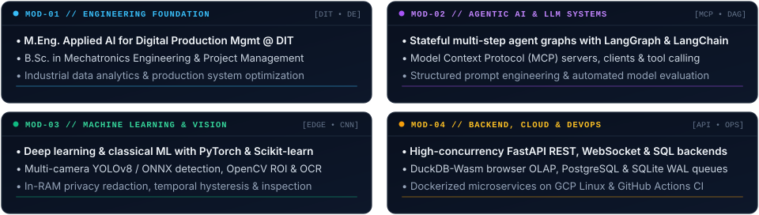
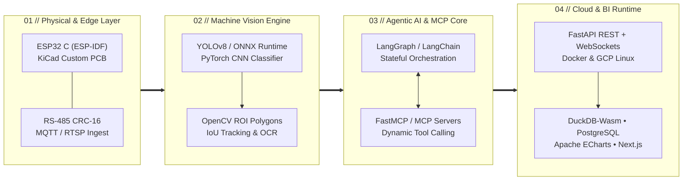

 

  
  
  

---

  

<b>🛰️ Inspect Full System Architecture &amp; Technical Matrix (Click to Expand)</b>

 

| 💻 Core Programming & APIs | 🧠 Machine Learning & Vision | 🤖 Agentic AI & LLM Systems | ☁️ Cloud, Data & DevOps |
| :--- | :--- | :--- | :--- |
| • Python & TypeScript | • PyTorch & Scikit-learn | • LangGraph & LangChain | • Docker & Docker Compose |
| • FastAPI (REST & WebSockets) | • YOLOv8 & ONNX Runtime | • Model Context Protocol (MCP) | • Google Cloud Platform (GCP) |
| • Embedded C (`ESP-IDF`) | • OpenCV ROI & Multi-Frame OCR | • Dynamic Tool Calling | • Linux & GitHub Actions CI/CD |
| • SQL, PostgreSQL & SQLite WAL | • Temporal Hysteresis & Tracking | • Structured Prompt Engineering | • DuckDB-Wasm & Apache ECharts |
| • RS-485 (`CRC-16`) & MQTT | • In-RAM Privacy Redaction | • Automated Model Evaluation | • KiCad PCB Design |

 

  

<table>
  <tr>
    <td width="50%" valign="top">
      <code>SYS-01 // EDGE VISION • EMBEDDED • FASTAPI</code>
      <h3>🅿️ <a href="https://github.com/aymanmali/smart-parking-guidance-system">Smart Parking Guidance &amp; Management System</a></h3>
      
End-to-end automated computer-vision parking guidance platform for a <b>300-slot facility</b> (4 zones × 75 slots, 12 edge cameras, 2 entrance counters, 4 intersection directional screens), inspired by my 2019 field deployment at <b>Galleria40 Mall (LEED-certified)</b>.

      <ul>
        <li><b>Edge Vision Pipeline:</b> YOLOv8 vehicle detection in PyTorch paired with calibrated per-slot OpenCV ROI polygons, a lightweight PyTorch CNN classifier, and temporal hysteresis filtering.</li>
        <li><b>Real-Time Guidance Backend:</b> FastAPI REST + WebSocket routing engine with an MQTT &amp; RS-485/CRC-16 hardware protocol bridge.</li>
        <li><b>Signage UI &amp; Custom Hardware:</b> React operator dashboard &amp; live LED signage simulator, plus ESP32 Embedded C (ESP-IDF) firmware and a custom KiCad PCB (<code>SPG-CTRL-v1</code>).</li>
      </ul>
      

        
<b>⚙️ System Telemetry &amp; Hardware Specs</b>

        <ul>
          <li><b>Field Pedigree:</b> Architected &amp; deployed in 2019 at Galleria40 (Sheikh Zayed, Egypt) to cut stall-search cruising and garage exhaust load.</li>
          <li><b>Wire Protocol:</b> Bit-accurate MODBUS/CRC-16 RS-485 binary framing with 15-second amber offline hardware failover and C99 unit tests.</li>
        </ul>
      

       
      
      
      
      
      
      
      
    </td>
    <td width="50%" valign="top">
      <code>SYS-02 // IN-BROWSER OLAP • BI • AST COMPILER</code>
      <h3>🦆 <a href="https://github.com/aymanmali/quackboard">QuackBoard: Open-Source BI &amp; Analytics Platform</a></h3>
      
Open-source, Tableau-style Business Intelligence web platform powered by <b>DuckDB-Wasm</b>, <b>Apache ECharts</b>, and <b>Next.js 15</b> for zero-setup browser file analytics and live SQL dashboards.

      <ul>
        <li><b>Hybrid Query Engine:</b> In-browser DuckDB-Wasm Web Worker SQL over CSV/Parquet/Excel/JSON files plus live PostgreSQL &amp; MySQL connections with AES-256-GCM encrypted credentials.</li>
        <li><b>Tableau-Style Chart Studio:</b> Drag-and-drop Dimension &amp; Measure shelves with 9 interactive chart types, date bucketing, and a read-only ad-hoc SQL Lab.</li>
        <li><b>Interactive Dashboards:</b> Drag-and-resize grid layouts, global filters, click-to-cross-filter across sibling charts, PNG/CSV export, and portable <code>.quackboard.json</code> import/export.</li>
      </ul>
      

        
<b>⚙️ Query Compiler &amp; Security Specs</b>

        <ul>
          <li><b>Visual AST Compiler:</b> Compiles shelf pills into parameterized, dialect-aware SQL (DuckDB / PostgreSQL / MySQL) with zero raw string interpolation.</li>
          <li><b>Read-Only Guardrails:</b> Single-pass SQL comment/literal scanner restricting ad-hoc queries to <code>SELECT</code>/<code>WITH</code> inside read-only transactions with query timeouts.</li>
        </ul>
      

       
      
      
      
      
      
      
      
    </td>
  </tr>
  <tr>
    <td colspan="2" valign="top">
      <code>SYS-03 // EDGE AI DAEMON • DSGVO PRIVACY-BY-DESIGN • BILINGUAL PORTALS (DE/EN)</code>
      <h3>🚘 <a href="https://github.com/aymanmali/parkvektor-private-de">ParkVektor Private DE: Barrierless ANPR Parking Platform</a></h3>
      
An independent barrier-free ANPR private parking &amp; ticketing MVP designed for <b>Germany</b> (malls, retail parks, hotels, hospitals) around <b>DSGVO Privacy-by-Design</b> principles and German civil/tax workflows (<code>BGB</code>, <code>§ 147 AO</code>, <code>§ 39 StVG</code>).

      <ul>
        <li><b>Hybrid Edge AI &amp; Smart ANPR:</b> Standalone Python Edge AI daemon (RTSP/ONVIF ingest, ONNX Runtime YOLO vehicle/plate detection, EU/DE slot+CTC plate OCR with IoU multi-frame voting, German <code>FE-Schrift</code> normalization, in-RAM face/windshield blurring, SQLite WAL offline sync) plus signed webhook adapters for commercial ANPR cameras (Axis, Adaptive Recognition, Hikvision, Generic JSON).</li>
        <li><b>Tariffs, Payments &amp; DSGVO Auto-Purge:</b> Flexible weekday/weekend tariffs, pluggable Stripe checkout (SEPA, Apple Pay, Google Pay, PayPal) with <code>19% MwSt.</code> PDF invoices, and automated raw-plate/snapshot purging with zero-PII audit logs.</li>
        <li><b>Bilingual Portals (DE/EN):</b> Next.js Driver QR Pay &amp; AutoPay wallets, German QWERTZ Pay-on-Foot Kiosk, Tenant Validation, Driver <i>Widerspruchsportal</i>, and Operator Admin / <code>§ 39 StVG</code> QA dashboard.</li>
      </ul>
      

        
<b>⚙️ Edge Daemon &amp; Privacy-by-Design Specs</b>

        <ul>
          <li><b>Zero-Unblurred Persistence:</b> Faces, windshields, and pedestrians are redacted irreversibly in RAM on the edge node prior to any disk write or S3 snapshot upload.</li>
          <li><b>Decoupled Tax Retention:</b> Settled parking sessions purge plate PII automatically while retaining immutable <code>§ 147 AO</code> accounting vouchers and zero-PII cryptographic purge audit logs.</li>
        </ul>
      

       
      
      
      
      
      
      
      
      
      
    </td>
  </tr>
</table>

  <i>Note: ParkVektor Private DE is an independent R&amp;D project (fictional Musterdaten &amp; synthetic simulation only) and is not affiliated with or endorsed by any third-party hardware or payment vendors.</i>

 

  

<table>
  <tr>
    <td align="center" width="50%">
      
      <h3><a href="https://github.com/aymanmali/quackboard">QuackBoard</a></h3>
      
      
Open-source Tableau-like Business Intelligence platform powered by DuckDB-Wasm, Apache ECharts, and Next.js.

    </td>
    <td align="center" width="50%">
      
      <h3><a href="https://github.com/aymanmali/smart-parking-guidance-system">Smart Parking Guidance System</a></h3>
      
      
Open-source 300-slot computer-vision parking guidance platform (YOLOv8, PyTorch, FastAPI, ESP32 C, KiCad PCB).

    </td>
  </tr>
  <tr>
    <td align="center" width="50%">
      
      <h3><a href="https://github.com/CopilotKit/openfuse">OpenFuse</a></h3>
      
      
CopilotKit's open-source personal agent with a browser, terminal, and files.

    </td>
    <td align="center" width="50%">
      
      <h3><a href="https://github.com/CopilotKit/OpenBot">OpenBot</a></h3>
      
      
CopilotKit's open-source AI coworkers, each with a computer of its own.

    </td>
  </tr>
  <tr>
    <td align="center" width="50%">
      
      <h3><a href="https://github.com/cline/cline">Cline</a></h3>
      
      
Autonomous coding agent as an IDE extension, CLI, and SDK.

    </td>
    <td align="center" width="50%">
      
      <h3><a href="https://github.com/PrefectHQ/fastmcp">FastMCP</a></h3>
      
      
The fast, Pythonic way to build MCP servers and clients.

    </td>
  </tr>
</table>

 

  

 

  

  
  
  
  
  
  
  

 

  

&nbsp;

  

---

<code>SYS.EOF // © 2026 Ayman Ali • Applied AI @ DIT • Munich, Germany 🇩🇪</code>

